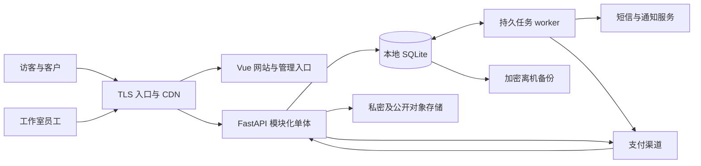

# 技术选型与架构设计

## 采用方案

采用模块化单体：Vue 前台与后台两个构建入口、一个 FastAPI 应用、一份业务 SQLite 数据库、一个可重启任务工作进程。图片与附件放对象存储，数据库只保存元数据。首发按单台应用主机设计，避免把小团队的运营系统拆成微服务。

| 层 | 选择 | 理由与限制 |
|---|---|---|
| 前端 | Vite、Vue 3、TypeScript strict、Vue Router | 页面按业务模块组织，路由懒加载 |
| 样式 | Tailwind CSS 4、CSS 变量 | 使用 `@tailwindcss/vite`；不混用 v3 初始化教程 |
| 状态 | Pinia + 集中 fetch 客户端 | Pinia 保存会话视图/购物车交互；服务端为订单权威源 |
| API | FastAPI、Pydantic 2 | 显式输入输出类型、OpenAPI、依赖注入 |
| 数据访问 | SQLAlchemy 2 + Alembic + SQLite | 首发选择同步会话及 FastAPI 同步路由；不在 async 路由直接运行阻塞 ORM |
| 外部网络 | httpx；经审查的渠道适配器 | 每个调用显式超时；不在持锁事务中访问网络 |
| 异步工作 | 数据库 outbox + 单独 worker | 可恢复、重试和去重；不用进程内 BackgroundTasks 承担收款账务 |
| 文件 | 兼容 S3 的对象存储、CDN | 公开作品与私密附件分桶或严格分前缀 |
| 运行入口 | Nginx/Caddy 二选一，默认 Nginx | 同域 `/api` 转发，TLS，静态内容与访问控制 |
| 验证 | pytest、Vitest、Playwright | 领域规则、接口集成、真实浏览器关键路径 |
| 工程质量 | Ruff、mypy、ESLint、vue-tsc | 锁依赖、检查类型、限制跨模块导入 |

I0 锁定安装当日互相兼容且仍受维护的补丁版本，提交 `pnpm-lock.yaml` 与 `uv.lock`，禁止部署时安装 `latest`。Node 选择受维护的 LTS 且满足 Vite 引擎要求；Python 以 3.12/3.13 中依赖验证通过的一版为基线。当前 Vite 文档要求 Node 20.19+ 或 22.12+，这只是最低版本条件，不代表允许选择已停止安全维护的版本。[Vite 官方说明](https://vite.dev/guide/)

Tailwind 4 对旧浏览器有限制，目标机型见 C23；需兼容更旧 WebView 时必须先验证 CSS 能力，不能只调 JS 编译目标。[Tailwind 升级指南](https://tailwindcss.com/docs/upgrade-guide)

## 系统关系



## 模块职责和依赖

| 模块 | 自己拥有的数据与职责 | 允许依赖的公开能力 |
|---|---|---|
| identity | 用户、验证码、会话、员工权限 | audit、通知端口 |
| content | 作品、公告、系列、FAQ、团队 | media |
| catalog | SKU、价格、角色商品、道具/周边分类、洗毛套餐与预约、库存 | media；不读订单表 |
| commissions | 询价、报价、档期、制作节点 | identity 访问主体、media、commerce 创建委托订单端口 |
| commerce | 购物车、订单、付款计划、库存协调、售后 | catalog 库存端口、payments 支付端口 |
| payments | 支付意图、已验证收款、退款、对账 | 渠道 adapter；通过应用层通知 commerce |
| loyalty | 积分账户、流水、奖励规则 | 消费稳定事件；不读支付内部表 |
| feedback | 用户反馈、审核、补件和回复 | media、loyalty 奖励命令 |
| media | 上传、扫描、派生图、访问授权 | 对象存储 adapter |
| notifications | 站内信、短信/邮件发送记录 | 渠道 adapter |
| audit | 操作审计与安全事件 | 无业务反向依赖 |
| platform | 配置、数据库 UoW、时钟、ID、outbox | 不放具体业务逻辑 |

跨模块流程由 `application/workflows` 编排，通过公开 `ports.py` 和 DTO 协作。子模块不互相导入 ORM 表、不调用另一个模块的 repository、不访问别人的私有函数。数据库外键可以跨模块，运行依赖不能形成环。通用组件不得引用订单/积分枚举。

`/wash`、`/props`、`/merch` 是三个展示入口，不新增业务模块：页面读取 catalog 的商品目录，洗毛预约复用 `stock_applications`（kind=cleaning）与审批状态机，道具/周边与 `/shop?category=props|merch` 共用同一目录、库存与详情页。前端页面放在 `web/src/modules/catalog/pages/`，文案与布局由 content 的站点壳承载。

同库强一致动作通过一个 UnitOfWork 执行：如订单生成与库存预留同时成功或回滚。通知与积分消费通过事务 outbox 最终一致；写业务记录和写 outbox 必须在同一事务。消费用 `event_id` + 消费者名去重，实现“至少一次投递、业务效果一次”，不声称网络恰好一次。

## 建议目录

```text
web/
  src/app/                  # 启动、路由组装、依赖注入
  src/modules/<domain>/     # pages、components、api、types、stores
  src/shared/ui/            # 无业务含义的按钮、对话框、表单控件
  src/shared/lib/           # HTTP、格式化、可访问性工具
  src/assets/brand/          # 经过处理的三组指定素材
  admin.html                # 后台独立入口，独立构建包
server/
  app/main.py
  app/platform/             # settings、db、clock、outbox
  app/modules/<domain>/
    router.py               # HTTP 输入输出与权限依赖
    schemas.py              # 公共 DTO
    service.py              # 用例协调和业务规则
    repository.py           # 本模块查询
    models.py               # 本模块 ORM
    ports.py                # 跨模块能力声明
  app/application/workflows/
  app/adapters/{sms,payments,storage}/
  app/worker.py
  migrations/
  tests/{unit,integration,contract}/
contracts/openapi.json      # 实现阶段由 FastAPI 导出
e2e/
deploy/
文档/
```

## SQLite 商用边界

数据库必须在应用主机的持久本地 SSD 上，不能放 NFS、网盘、对象存储挂载或无持久卷的函数运行环境。WAL 支持读写并行，但同时只能有一个写入者。[SQLite WAL 文档](https://www.sqlite.org/wal.html)

- 每个连接启用 `foreign_keys=ON`、`busy_timeout=5000`；数据库启用 WAL。金融数据以 `synchronous=FULL` 为初始耐久性设置，通过实测决定是否调整，不能默认降低。
- 一个 API worker 起步，任务 worker 也会争用写锁；进程数限制不代替事务控制。事务尽量短，金额/库存争用使用 `BEGIN IMMEDIATE` 或带条件的原子更新，不能假设 `SELECT FOR UPDATE` 在 SQLite 生效。
- 支付验签、对象扫描、短信调用放事务外；事务内只验证当前状态、写账和事件。
- `SQLITE_BUSY` 有限退避；整笔幂等业务可重试，不能在已调用外部支付之后无条件重跑全部逻辑。
- 读缓存及 CDN 降低展示流量；数据库不能因用户访问一次页面就更新计数。
- 持续 15 分钟 `SQLITE_BUSY` 超过业务写入的 0.5%、P95 写入等待超过 200ms、需要多机高可用或活动峰值压测不通过时，启动 PostgreSQL 迁移评估。这些是本项目工程阈值，不是 SQLite 官方容量上限。
- PostgreSQL 升级保持 repository/ports 契约，迁移先对账行数、金额汇总和唯一约束，再停写切换；禁止在上线中途引入无校验双写。

## 关键架构决策

| ADR | 决定 | 撤销条件 |
|---|---|---|
| ADR-01 | 模块化单体 | 团队/流量证据证明某模块需独立扩容后再拆 |
| ADR-02 | 同域 BFF 风格接口与 HttpOnly 不透明会话 | 出现经确认的原生客户端/OAuth 需求后另写 ADR |
| ADR-03 | SQLite 单主机与 outbox | 达到上节阈值或业务明确要求多机容灾 |
| ADR-04 | 公开内容预渲染，账户交易页 SPA | 内容更新频率/SEO 指标证明需 SSR 时评估；保持 Vite/Vue |
| ADR-05 | 人工最终报价 | 规则估价可扩展，但不能替代制作人员确认 |
| ADR-06 | 支付渠道适配器隔离 | 更换渠道只改 adapter/配置和契约测试 |

公开页面用 Vite 的 SSR 构建能力与 Vue 服务端渲染在发布任务中生成静态 HTML，页面清单来自已发布 CMS 版本；任务失败保留上一版本。API 仍判定最新库存/价格。不要把私密账户页面和个性化数据预渲染到 CDN。FastAPI 的进程、HTTPS 和重启职责参考[官方部署文档](https://fastapi.tiangolo.com/deployment/)，本项目的单 worker 是 SQLite 基线选择，不是 FastAPI 的普遍要求。
