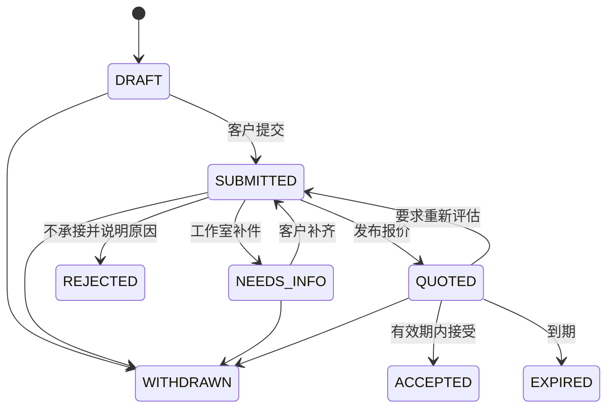

# 委托报价与制作流程

适用 FR-006–FR-010、FR-020。询价是需求沟通记录，报价是有期限的商业提案，订单才承载实际收款与履约。三个对象分开保存。

保养服务（FR-025）不是委托：它走 `stock_applications` 的 cleaning 申请与商城订单，状态机见 08，不进入本文件的询价、报价版本、名额与合同流程，避免同一服务存在两套审批状态。

公开参考估价（FR-026）是询价前的独立入口：访客无需登录，按系列起价、风格系数与加项得到参考区间并提交联系方式。估价请求不关联用户、不锁库存、不生成报价或订单，也不进入询价状态机；工作人员联系后再由登录用户提交正式询价。参考区间不是商业报价。

## 询价表单

| 字段 | 约束 | 用途 |
|---|---|---|
| character_name | 必填，1–60 字 | 角色识别 |
| species | 必填，1–60 字，可选枚举+补充 | 制作评估 |
| series_id / suit_type | 必填，系列有效；全装/半装/单头/其他 | 确定报价范围 |
| design_asset_ids | 1–3 张，单张 ≤10MiB | 清晰设定图；文件安全规则见 10 |
| requirements | 0–3000 字 | 花纹、结构、配件和其他要求 |
| budget_min/max | 可选，整数分，min ≤ max | 仅辅助沟通，不自动定价 |
| target_date | 可选，日期 | 意向日期，不等于交付承诺 |
| delivery_region | 国家/省级范围 | 估算运输可行性；完整地址留到下单 |
| contact_preference | 可选 QQ/微信/邮箱 | 手机号来自已验证账号；其他联系渠道不代表已验证 |
| rights_declaration | 必选 | 确认有权提供角色设定；版本化留证 |

量体信息默认在接单后单独收集，不仿照参考站在首次询价收齐生日、性别、住址。高度/围度单位 cm，重量 kg，表单显示单位并支持小数；范围只做异常提示，特殊体型交工作人员确认，禁止硬编码排除用户。

## 状态及允许动作

已接受询价不能直接撤回，只能取消对应未付款订单或进入售后。终态不删除，重新申请建立新记录并关联原单。客户提交后不覆盖工作人员已见版本；补件产生新版本及时间记录。

## 报价版本

报价包含 `quote_id、version、currency、line_items、total_cents、prepayment_cents、balance_cents、expires_at、estimated_start、estimated_delivery、included_revisions、exclusions、terms_version、issuer_id`。

前端估价仅用于理解价格区间；最终可支付金额以工作人员发布的服务端版本为准。发布新报价将旧版设为 SUPERSEDED；接受接口带 `quote_version`，同一报价只生成一个订单。接受时同一事务验证当前版本、有效期、用户归属、名额资格、条款版本，写订单与款项快照。若中途改价，返回 `QUOTE_CHANGED`，不能静默加价。

基线有效期 7 天，预付款比例作为配置草案等待 C06/C08。资料不足显示 NEEDS_INFO，不发送可支付链接。报价失败与拒单都应说明可修改的原因，不能只给“失败”。

## 名额与档期

普通申请默认先人工筛选，再在接受报价时预留名额；预留 30 分钟用于付款，截止前未完成收款进入关闭核对，确认渠道无在途付款后释放。已付预付款才转成正式占用。询价、入选、预留、正式占用四者在页面上分开表述。

`schedule_round` 保存时区、UTC 开始/截止、capacity、reserved_count、committed_count。唯一约束 `(round_id,user_id)` 防同一轮重复申请。容量更新用条件 SQL，约束 `reserved_count + committed_count <= capacity`。若一人可多个角色，需经 C11 改唯一规则和验收用例。

公开排期只展示匿名编号、阶段和经授权角色名，不能显示手机号、完整姓名、详细地址、量体或真实订单流水号。

限时拼手速是可选扩展 C11。若启用，以数据库分配的单调序号作为排位，以服务端时间判定资格；按钮倒计时不具备裁决权。相同账号只分配一次序号，重试返回原结果。设计验证码预验证、入口限流、公平说明、候补和取消释放；不能宣称网络请求先后等同用户实际点击先后。压测不通过时保持关闭。

## 合同与条款

报价接受与付款前展示经营主体、范围、金额、预付款性质、交付安排、修改次数、取消规则、质量售后、图像公开授权。用户主动勾选，记录条款版本、正文摘要哈希、订单 ID、同意时间、必要审计信息。

默认用“预付款”，不把所有首期付款都称“定金”。若采用具有定金法律效果的安排，见 C06 的法律审核项。网站勾选留证不自动等同具有可靠电子签名能力；是否接电子签服务见 C07。

展示授权单独选择，拒绝授权不影响正常下单。售后义务不能因为用户不愿宣传被剥夺。参考站合同只提供页面组织参考，不复制其免责、逾期没收或最终解释权条款。

## 制作与变更

制作单状态：`QUEUED → MEASUREMENT_PENDING → DESIGN_CONFIRMING → MATERIALS_READY → PRODUCING → CUSTOMER_REVIEW → READY_TO_SHIP → SHIPPED → COMPLETED`。状态是业务基线，具体阶段可配置，但不能跳过尾款校验发货。

每个阶段记录负责人、开始时间、预计日期、说明、私密图片、需客户确认标记、确认版本、客户确认时间。客户可以确认或提出修改；工作人员不能代替客户伪造确认。等待客户回复造成延期需有可查记录。

重大加项生成 change_request，明确新金额、延期、条款版本；客户接受后生成单独补款 installment，已经成功的付款和旧合同快照不改。减项通过退款或减少未付款项表达，保持账务可追踪。

## 失败与恢复

- 草稿保存失败保留本次输入并提示重试；退出账号后清除敏感本地草稿。
- 上传成功但询价提交失败，附件按 upload ownership 继续可复用，未引用附件按生命周期清理。
- 付款在名额过期后到达，记录真实收款并标为异常，转人工安排或原路退款；不能自动多占名额。
- 工作室延期需要更新预计时间与原因并通知客户；客户撤销按订单阶段和已确认政策处理。
- 角色汤取消后的角色是否重新上架由运营审核，不能因退款回调自动公开设定图或复售。
