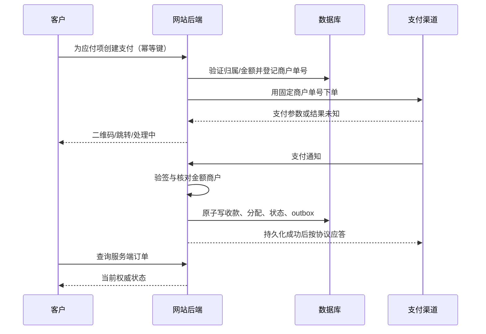

# 商城订单支付与退款

本文件是金额、库存、订单、收款、退款的唯一规则源。适用 FR-011–FR-013；C04/C06/C08/C10/C16/C17/C21 确定业务配置。

## 商品与结算

商品类型为 `stock_goods`（现货/配件/道具）、`exclusive_character`（独占角色）、`commission`（已确认报价的定制单）、`service`（报价后履约）。商品分类 `category` 为 `stock`、`accessory`、`props`（道具）、`merch`（周边展示）、`service`、`character`；`/props` 与 `/merch` 只是同一目录的专题入口，不复制商品与库存。**`merch` 当前只展示、不售卖**：商品与详情不显示价格/库存/加购，加购、结算预览和下单统一返回 409 `MERCH_DISPLAY_ONLY`，不生成周边订单；未来开放售卖需新的需求确认。不混合定制付款计划与普通现货购物车；首发一个订单只有一种履约类型。

金额统一存整数分，币种显式 CNY 或 USD（C02/C24），单笔订单不得混用；禁止 float、负数或超上限金额。商品单价、SKU 描述、税费/开票信息、运费、优惠分摊、购买条款与地址以订单快照保存。购物车价格只作展示。

`order_total = Σ(unit_price × quantity) - discount_total + shipping_total`。应付金额由服务端依据当前商品、促销、配送范围计算。客户端只能提交 SKU、数量、地址 ID 和优惠选择，不得直接决定单价或积分。

结算预览返回一次性 `checkout_token`、有效期和金额摘要。创建订单重新校验价格与库存；不一致返回 `PRICE_CHANGED` 或 `STOCK_NOT_ENOUGH`，要求用户看见变化后再次确认。地址快照加密，运营改地址产生履约变更记录，不覆盖原始证据。

## 区域运费与税费配置（C02/C24）

`commerce.policy.regions` 的各区可配置 `shipping` 和 `cross_border`。区域运费的 `currency` 必须与该区币种一致，固定运费、免邮门槛、偏远附加费与运费上限均须显式提供整数分；零值也必须明确填写，不继承其他币种的金额。

结算以收货地址判定区域。仅站点同币种区域可沿用全局运费模板；其他币种区域未配置独立模板时返回 403 `FEATURE_DISABLED`。关税比例只在启用后给出预估，不计入应付金额；未配置区域税费时沿用全局预估开关与说明，默认关闭。N07 的正式运费与税率仍待确认，测试值不能用作商业配置。

## 库存预留

1. 事务内校验 SKU 可售，原子增加 reserved，条件 `stock_on_hand - reserved >= quantity`。
2. 同事务创建 order、order_items、inventory_reservations 与应付 installment，返回 PENDING_PAYMENT。
3. 已核验收款被分配至该应付项后：`stock_on_hand -= qty; reserved -= qty`，预留状态转 CONSUMED。
4. 到期进入 CLOSING，先关闭或查询渠道；确认没有在途成功付款后取消并释放预留。支付成功与释放用版本/条件更新竞争，不允许同时发生。
5. 售后退款不自动补库存。商品回仓检验合格，或独占角色经授权与运营审核可复售后，才创建补库存动作。

独占角色只能绑定一个销售 SKU，库存固定为 1。若付款晚于已确认关闭及释放，记下真实收款为 OVERPAYMENT/异常待处置，不重新扣已经售出的角色库存。

## 洗毛与护理服务（FR-025）

洗毛按部件拆成独立服务商品（单头 / 半装 / 全装，可再配附加项），`kind=service`、`service_kind=cleaning`、`requires_approval=true`（C28 服务先申请再报价）。预约流程：

1. 用户在 `/wash` 选套餐，填写部件、期望日期与返还方式，提交 `stock_applications`（`kind=cleaning`）；预约不锁库存、不付款。
2. 运营在后台确认材质、档期与风险，通过时给出优先级与购买窗口；流程与 C28 掉落审批共用状态机。
3. 用户在窗口内按报价下单付款；服务类订单不收运费，`return_method=ship` 的寄回运费单独列示，不隐式并入服务价。
4. 到店交付或寄出后进入履约；完成后按实付金额计入星绒币，规则与普通订单一致。

预约日期只表示期望，不构成档期承诺；运营拒绝或改期必须给出理由。服务订单的取消与退款适用 C10 定制/服务条款，未开始履约与已开始履约分别处理；已产生的寄回运费不因服务退款自动退还。

## 分离状态

| 对象 | 状态 | 说明 |
|---|---|---|
| order | PENDING_PAYMENT、ACTIVE、FULFILLING、SHIPPED、COMPLETED、CANCELLED | 履约状态，退款另有汇总标志 |
| installment | DUE、PAYING、PAID、CLOSING、CLOSED | 现货一个全款项；委托有预付款/尾款/已确认加项 |
| payment_attempt | CREATED、PENDING、UNKNOWN、SUCCEEDED、CLOSED、FAILED | UNKNOWN 必须查单；成功记录不改回失败 |
| payment_allocation | APPLIED、OVERPAYMENT、QUARANTINED | 成功款分配到应付项，或判为多付/待人工核对 |
| refund | REQUESTED、APPROVED、PROCESSING、UNKNOWN、SUCCEEDED、FAILED、REJECTED | 失败或未知不能直接说钱已退 |
| after_sale | OPEN、NEEDS_INFO、APPROVED、RETURNING、RESOLVED、REJECTED | 售后流程，不等于退款渠道结果 |

界面上的“部分退款/全额退款”来自退款分配汇总；支付 SUCCEEDED 记录永久保留。订单能因质量问题退款但仍记录曾经完成交付。

`paid_cents` 只计 APPLIED 分配，`refunded_applied_cents` 只计已成功退款且指向 APPLIED 的分配。多付款的退款不能扣减正常订单实收。每笔退款同时关联收款、分配、订单行/运费分摊。

## 支付渠道与客户端

| 场景 | 方案候选 | 注意事项 |
|---|---|---|
| 电脑网页 | 微信 Native 二维码、支付宝电脑网站支付 | 二维码过期能重新获取；旧支付结果仍需核对 |
| 手机外部浏览器 | 微信 H5、支付宝手机网站支付 | 商户资质、域名、渠道能力需实际开通 |
| 微信内浏览器 | 微信 JSAPI | 需要相应 AppID/openid 及授权流程，不能把手机验证码登录等同微信身份 |

渠道不可用时明确显示可用方式，不生成伪支付成功页。`PaymentGateway` 至少定义 create/query/close/refund/query_refund/download_bill/verify_notification。支付宝可以评估官方 Python SDK；微信 Python 库的官方性和维护状态需 I0 核验，不将社区库称为官方。签名算法与证书模式依据商户当前官方文档实施。

## 支付时序

成功状态只能由已验签且核对完整的通知，或服务端主动查单确认。返回页、用户截图、前端 JS 回调都不直接入账。

回调处理 MUST：保留验签所需原始字节；核对可信平台公钥/证书序列及轮换、时间戳/重放规则；解密后核对商户、应用、订单号、币种和金额；按渠道交易号与事件号去重。IP 限制仅作辅助，不能代替验签。通知已处理则返回原成功结果，不能再次加金额、扣库存或发积分。

官方依据：[微信 APIv3 SDK 的通知验签与解密](https://github.com/wechatpay-apiv3/wechatpay-go)、[支付宝官方 Python SDK](https://github.com/alipay/alipay-sdk-python-all)。这两个来源支持集成安全能力，具体支付产品准入、参数与回调应答仍须在商户开通时复核。

## 幂等和异常资金

- 创建支付前持久化唯一商户单号。渠道超时返回 UNKNOWN，用同单号查单；禁止立即换新单号再下单。
- 同一应付项默认一个活动支付尝试；切换渠道前关闭旧单并核对。即使两个渠道都真正收款，也必须逐笔记录：事务内只分配应付余额，剩余进入 OVERPAYMENT 并触发退款流程。
- `Idempotency-Key` 按主体+动作+键唯一，保存请求规范化哈希；同键不同请求 409。同键重试返回同资源。财务业务唯一号长期保留，HTTP 响应缓存期限不会取消业务防重能力。
- 回调先到而创建支付响应后到：按预先落库的商户单号关联；后到响应不可把 SUCCEEDED 覆盖为 PENDING。
- 收款成功但本地事务失败：不给成功应答，等待重试并主动查单。任务不能假设回调一定会到。

## 退款

客户发起售后 → 客服核查 → 财务批准 → 生成唯一 `out_refund_no` → 调渠道 → 回调/查单证实 → 写退款成功与分摊 → 发出 RefundSucceeded 事件。审批与执行分开授权，重试使用同退款号。

可退额 = 原收款金额 - 已成功退款 - PROCESSING/UNKNOWN/APPROVED 中的预留退款额。退款申请事务必须原子预留额度，防两个客服各退一次。明确失败且渠道证明未退才释放预留；UNKNOWN 继续查单。

退款按原渠道退给原付款来源，不能随意改收款账号。部分退款分配到商品行、运费及已用优惠；不能超过各行剩余实付分摊。存在多次付款时按付款原单拆分多个退款子项，各子项分别查证。退款后的积分调整不应阻碍依法应退的现金。

售后政策 C10、发票与运费 C17、优惠券 C16 未确认时，只使用沙盒业务规则。定制商品的特殊退货条件不消除质量瑕疵责任。

## 对账和审计

每 5 分钟处理近期 UNKNOWN/PENDING，采用有上限退避；支付通知通常即时处理。每天拉取已具备账单的交易日账单，比较商户号、币种、交易号、金额、退款与手续费。不同渠道账单可用时间不同，由 adapter 配置，不硬编码为次日零点必可下载。

差异分为渠道有本地无、本地成功渠道无、金额不符、重复支付、退款不符、手续费不符。生成异常任务、保留证据、人工关闭理由；不允许批量“标记一致”。恢复备份后对恢复时间之后全部渠道交易重新查账，不能只恢复数据库就重新接单。

验收至少覆盖：重复通知、乱序、错签名、错金额、超时未知、双渠道多付、迟到支付、并发最后一件库存、部分退款多次取整、退款重试、服务器重启后恢复。具体编号见 13。
