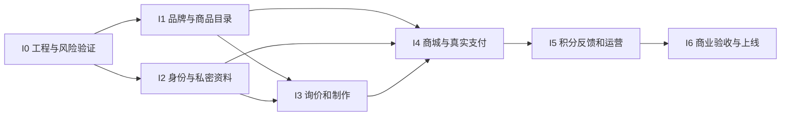

# 增量开发计划

开发模型为 Incremental Model。每个增量走“需求与契约 → 数据/领域实现 → 前端及后台 → 验证 → 演示与反馈 → 基线更新”。上个增量通过后保留可运行版本，下个增量只增加已声明能力；不是先堆完所有页面再补后端。

## 增量依赖

I1/I2 可在接口稳定后由同一团队分别推进；此图不是要求 AI 自动启动多个代理。所有增量包含本模块安全控制，I6 是复核与实战演练，不是首次考虑安全。

| 增量 | 交付范围 | 依赖/准备 | 可演示结果 | 退出条件 |
|---|---|---|---|---|
| I0 | 仓库结构、锁依赖、CI、配置、SQLite/UoW、错误协议、OpenAPI 骨架；支付/SMS adapter 原型 | C01/C02/C03/C23/C25 记录；研究支付准入 | 空服务/站点可启动，迁移可跑，版本可追溯 | 安装构建通过；数据库写锁/备份小实验通过；没有明文密钥 |
| I1 | 品牌首页、作品、系列、角色、商品目录、FAQ/公告、CMS 内容后台和素材派生 | I0；C09/C12/C18/C20/C26 内容范围 | 编辑草稿、发布、用户浏览与筛选 | 路由/公开权限/图片/SEO/移动端检查通过 |
| I2 | 手机登录、会话、员工 MFA/RBAC、私密上传、地址、隐私同意与审计 | I0；C05/C19/C21/C22 | 用户短信登录，员工看受限数据，附件仅本人可读 | 真通道测试或明确沙盒；OTP 重放/限流/越权测试通过 |
| I3 | 询价草稿、补件、报价版本、普通名额、合同留证、制作节点 | I1/I2；C06–C11/C30 | 询价→报价→未付款订单→制作演示数据 | 过期/旧版拒绝；最后名额竞争通过；付款待 I4 接入 |
| I4 | 购物车、库存、订单、付款计划、渠道支付/退款/查单/对账、物流售后/发票 | I3；C04/C10/C16/C17/C21 | 现货与委托真实商业流程在测试环境完成 | TC-P/TC-O 全通过；无假支付；账务和库存一致 |
| I5 | 购买奖励、退款扣回、反馈审核奖励、积分后台、邮件投递与失败重试、站内通知中心（C27 2026-09-18 修订：站内通知与邮件并存） | I4；C13–C15/C27/C30 | 一笔购买和一条反馈获积分，再演示退款调整 | 账本可重算；重复事件/刷分/复审/乱序测试通过 |
| I6 | 负载安全检查、全链验收、部署、监控、备份恢复、操作培训 | I1–I5；商业阻断项落实 | 小范围真实交易与退款验收，故障恢复演练 | 13/14 上线门槛全通过；业务签收、值班与回滚可执行 |
| I7 | 洗毛预约、道具工坊、周边展示、设计系统 v5（FR-025，2026-11-04 新增/修订） | I1/I4；C28/C31–C33 | 三张专题页可浏览；洗毛预约可提交并在后台看到日期与返还方式；道具可交易，周边只展示 | 分类过滤/预约校验/周边 409 拒绝/页面状态/移动端通过；不复制商品与库存 |
| I8 | 公开参考估价、首页轮播极简与后台估价请求（FR-026，2026-11-04 新增/修订） | I1/I4；C28/C34 | 匿名可查看参考区间并提交；后台可联系/关闭；首页轮播极简 | 不登录可提交；限流与校验通过；估价不生成订单；轮播可暂停且适配 reduced-motion |

当前进度（2026-09-18）：I0–I5 已有实现与局部测试，但均未通过验收。审计 AUDIT-20260918 结论为 PARTIAL，6 项复现缺陷与双区双语、电子签与监护人、兑换抵扣等缺口尚未关闭，I6 商业上线不通过；逐条需求状态见 16 需求追踪矩阵，缺陷修复进展见 `文档/修复/项目修复任务清单.md`。表中 I1–I6 的交付范围是计划口径，不代表已完成。

“真实交易验收”在商户与负责人许可下使用允许的测试方式和金额，不能让模型未经授权自付费用。若某渠道无完整沙盒，则在开发阶段用明确标记的契约桩验证故障分支，商业验收补该渠道受控真实测试。

## 原子任务包

每个任务只覆盖一个可验证行为，通常涉及 1 个主要模块和少数接口文件；跨模块金额/状态变更按事务整体交付，不为控制文件数拆断原子性。

| 任务 | 内容 | 需求/证据 |
|---|---|---|
| T00 | 项目脚手架、配置校验、锁文件与 CI | NFR-08；冷启动构建记录 |
| T01 | UoW、SQLite 初始化、首个迁移、outbox/worker 骨架 | FR-019；锁冲突与重启恢复测试 |
| T02 | 素材 manifest、派生图、基础布局与状态组件 | FR-001；指定素材视觉检查 |
| T03 | CMS 发布/预览/公开读取、作品/系列/FAQ 页面 | FR-001–003；草稿不可见 |
| T04 | 商品/SKU/角色管理与公开目录 | FR-004/011；售罄与权限 |
| T05 | OTP、会话/CSRF、退出和撤销 | FR-005；TC-A01–A03 |
| T06 | 员工 MFA/RBAC、审计 | FR-016；TC-A05 |
| T07 | 私密上传、扫描、引用授权与清理 | FR-006；TC-U01/U02 |
| T08 | 询价草稿/提交/补件/撤回 | FR-006；TC-C01 |
| T09 | 报价版本/名额/接受报价/条款快照 | FR-007–009；TC-C02–C04 |
| T10 | 制作阶段/量体/确认/变更 | FR-010；TC-C05 |
| T11 | 购物车/结算/原子库存预留/订单 | FR-011；TC-O01–O03 |
| T12 | 支付 adapter/意图/通知验签/收款分配 | FR-012；TC-P01–P06 |
| T13 | 关单/主动查询/多付处理/对账 | FR-012；TC-P07/P08 |
| T14 | 售后/退款审批/分摊/物流/发票 | FR-013；TC-P09–P11/TC-O04 |
| T15 | 积分账本/规则版本/购买奖励/退款扣回 | FR-014；TC-L01–L04 |
| T16 | 反馈/审核/预算/奖励/申诉 | FR-015；TC-F01–F03 |
| T17 | 交易邮件/短信投递、任务管理、失败告警（C27 邮件必选） | FR-017；TC-R01 |
| T18 | 生产发布、性能、安全、备份恢复、运营演练 | FR-018/019；TC-R02–R04 |
| T19 | 商品分类扩展（props/merch）、专题页 `/props`、`/merch` 与商城联动 | FR-011/025；TC-M01–M03 |
| T20 | 洗毛套餐、预约字段与迁移、`/wash` 表单与后台可见 | FR-025；TC-W01–W04 |
| T21 | 设计系统 v2：token、字体、圆角、按钮、头部/页脚、首页与商城重做 | FR-001/025；界面验收与对比度检查 |
| T22 | 公开估价模型/迁移/API、`/estimate` 页面、后台估价请求、首页轮播极简与文档同步 | FR-026；TC-E01–E05 |

## 每个增量的完成定义

- 需求和 API 没有与既有基线冲突；所有新增规则有唯一维护位置。
- 用户能完成该增量承诺的端到端行为，前端不依赖假成功响应；沙盒标识明确。
- 正常、权限、异常与关键并发用例通过；有命令、结果、环境与失败说明。
- 迁移、配置、回滚方式和操作说明一同交付；没有把生产手工改库作为正常步骤。
- 未决 Cxx 进入同一清单，功能开关状态可见；没有静默删除未完成事项。

## 风险与变更

优先验证渠道资质、短信可达率、SQLite 锁竞争、角色独占销售和私密上传。若关键实验失败，停在该增量修复约束或修改 ADR；不把风险转移到上线后。每轮反馈形成范围变更记录，对已完成增量补相应回归测试。

范围稳定后估算人员工时，区分开发、内容准备、服务审核、测试和法务等待。外部资质审核不能按代码完成时间推定完成。I6 不通过则保持展示/测试环境，不能称商业首发交付。
